# Phase 3C: live browser viewing, replay and ordinary-launch rollout

Status: **Proposal for alignment; no 3C implementation or new live trials.** Baseline **`711ddb7`**, the committed Phase 3B owner and manual-test/background-window repairs. Its latest validation passed 235 offline checks; earlier release/live records retain their own exact builds. Prepared 2026-10-30 against the actual code and pinned runtime.

## 1. Tangible changes

An ordinary browser task should produce one updating session card. **Watch** opens a current, read-only view of that browser, including while the agent thinks, a page loads or an approval is pending. Closing/reopening the viewer or reloading Zeus should recover the current frame and status. **Replay** lets the user inspect each managed request and actual outcome, with available before/after images and explicit gaps. Stop/error/restart preserve partial history.

This phase includes the integration needed to make the new owner usable in **normal launches**, replacing the current development-only boundary after acceptance. An unconfigured runtime must give setup guidance, not silently run the old implementation. The user must be able to tell which path is active without interpreting a debug log.

Replay means an ordered action/evidence history, not a pixel-perfect movie or re-execution of the website. Live preview is sampled, not a high-frame-rate remote desktop. A successful click, a captured image, a closed browser and a verified user goal remain separate facts. General completion/memory, Smart approvals and Team supervision keep their focused designs; a blocker in those areas cannot be relabelled a passing end-to-end task.

## 2. Decisions to scan

| Area | Current behavior | Proposed change |
|---|---|---|
| User rollout | Managed ownership is an environment opt-in; ordinary launches remain legacy | Visible global default plus optional task override, frozen per root run. Promote managed mode only after normal-launch acceptance. |
| Live source | Legacy frames follow instrumented actions; 3B's idle capture exists only as a probe | Independent capture in the existing owner, with a bounded latest-frame path that never waits for the actor's command queue. |
| Transport | Large image strings/events and arbitrary file URLs | Small identity/version notifications; one bounded, authorized binary image fetch at a time. |
| Reopening | Last action/manifest and premature completion timestamps drive hydration | Subscribe first, hydrate authoritative session/capture state, reject stale responses and wrong identities. |
| Replay | Entire manifest and all images load together | Cursor-paged journal; load only the selected/adjacent images; retain explicit image and recording coverage. |
| Evidence | Some legacy actions are recorded before execution; screenshots can be missing | Actual action outcome remains authoritative. Associate explicitly timed before/after captures or state that an image is unavailable. |
| Viewer failure | Broken image can leave an indefinite waiting screen | Distinct waiting, live, stale, capture-error, no-tab, closed, stopped, failed and interrupted states, with last-frame age. |
| Agent perception | Browser screenshots are paths; a further visual tool call is needed | Explicit screenshot observations deliver actual pixels through the calling role's existing direct/helper route, with normal budgets and provenance. Passive viewing uses no LLM. |
| Dynamic controls | Text/ARIA may omit visual state; arbitrary markup dumps encourage guessing | A bounded read-only element inspection contract and real keyboard-widget tests. Unknown evidence remains unknown; no site-specific interpretation. |
| Older history | Legacy manifests can be mistaken for verified execution | Separate legacy adapter and limited-coverage labels; preserve files and tighten unsafe path/image reads. |
| Storage | On-demand artifacts exist; complete recording retention is undefined | Fixed transient buffers, bounded archive budgets, explicit quota gaps and per-recording export/delete. No silent eviction of old user history. |

## 3. Findings at the checkpoint

- `BrowserLiveViewModal.jsx` fetches a whole legacy session before installing listeners, hydrates from its last action, trusts `completed_at` and falls back to arbitrary file URLs. It does not order frame events or bind every update to task/root/generation. Its completed banner implies successful autonomous execution.
- `BrowserSessionReplayModal.jsx` reads the entire session, renders every timeline pill and does not discard a late fetch after switching sessions. Its step records do not establish actual success. Image failure handling is incomplete.
- `browser_manager.rs::get_browser_session` interpolates task/session into a manifest path, accepts manifest-provided absolute image paths and base64-encodes every image. Existing readers need containment/size checks as well as pagination.
- `ManagedBrowserSessionCard.jsx` correctly reports viewer unavailability. `browser_store.rs` already has session/action/tab/artifact identity, versioned status and uncertain effects; capture history is not yet represented.
- `service.py::capture` proves that real pixels can change without actor calls. Its prototype overwrites `latest.jpg`/`latest.json` separately and suppresses capture exceptions. Rust does not enable/collect it. It has no production identity, error, quota or reader-race contract.
- Rust's `Broker` owns serialized request/response stdio under the action lock. Fetching every live frame through that path would stall during a long navigation or approval-related execution. Merely adding frontend polling is insufficient.
- The historical `tests/e2e/browser_replay_ui.spec.js` fabricates one-pixel images/manifests and is outside the current offline allowlist. It is presentation evidence, not real capture acceptance.
- The recent manual test used the old route. Its unknown-feedback, hidden-input, objective-drift and broad resource-fetching failures inform general tests; they do not justify a dedicated game solver. See [the investigation](PHASE_3B_MANUAL_FOLLOWUP.md).

## 4. Research and alternatives

Primary documentation checked on 2026-10-30, with local API availability checked in Playwright **1.62.0** and Tauri **2.11.5**:

- Playwright screenshots support viewport images, JPEG quality, CSS-pixel scale, locator masks and timeouts. These permit bounded preview frames without full-page captures. [Page screenshot API](https://playwright.dev/python/docs/api/class-page#page-screenshot).
- The pinned SDK also exposes public `page.screencast.start(on_frame=...)`; it is not necessary to introduce raw CDP for streaming. Its start options do not provide screenshot locator masks, and frame sizing can be affected by an existing recording. Newer documented options such as v1.64 styling/FPS must not be assumed available locally. [Screencast](https://playwright.dev/python/docs/api/class-screencast).
- Tauri supports efficient binary command responses through `tauri::ipc::Response`. Its event system is unsuitable for large data volumes, while channels support ordered streaming. [Binary responses](https://v2.tauri.app/develop/calling-rust/#returning-array-buffers), [events/channels](https://v2.tauri.app/develop/calling-frontend/#channels).
- Playwright traces provide useful browser/network/DOM debugging but do not themselves establish outcome assertions. [Tracing](https://playwright.dev/python/docs/api/class-tracing).

**Recommend extending masked screenshot sampling and the proven local mailbox**, with a production publication/collection contract. This avoids a second browser or a general rewrite of the actor broker. It retains existing masking and suits a low-rate observer. Native Screencast is a future optimization if measurements show this is inadequate and its masking/size/backpressure behavior is validated. No simultaneous competing capture architectures.

Do not use a full trace/video as the primary app history. It adds private DOM/network data, retention costs and finalization/recovery concerns, while still needing Zeus's authorization/outcome journal. Keep optional trace diagnostics outside this packet's required deliverable. Do not embed a remotely hosted viewer or execute stored page HTML/JavaScript.

## 5. Independent capture contract

```mermaid
flowchart LR
  A[Actor tools and Python clients] --> G[Rust policy and action journal]
  G --> P[Existing Playwright owner]
  P --> C[Independent capture scheduler]
  C --> M[Bounded owned mailbox]
  M --> R[Rust collector and validation]
  R --> D[SQLite capture metadata and retained artifacts]
  D --> B[Read-only bridge APIs]
  B --> V[Live View and Replay]
```

The service keeps one event-loop owner for browser objects. Its independent scheduler samples the current automation tab; Rust collection and UI image reads never acquire the mutation lease or the broker's action-I/O lock. Do not emit unsolicited image messages into the existing request/response stdout protocol.

Replace the probe's unbound mutable files with a host-derived mailbox under the owned runtime session directory, outside ordinary task outputs. Publish JPEG bytes into bounded alternating slots, then atomically replace a bounded descriptor. Include protocol, task/root/session/generation, monotonically increasing capture sequence, tab/revision, capture start/end, viewport dimensions, encoded size/hash, capture state and latest error. Never accept an actor-supplied path, identity or capture success event.

Rust reads the descriptor, validates identity/containment/reparse status, bounds and hash, and rechecks the descriptor after reading bytes. Validate actual image MIME/dimensions against the viewport and allocation limits rather than trusting descriptor fields. A slot replaced during reading is a skipped frame/retry, never a mixed successful image. Windows replacement/sharing failures must preserve the last valid publication and report the failure. Use bounded reads/retries; no metadata-controlled allocations or unbounded directory scans. Known-good bytes enter a small backend cache; a stale frame reference returns expired rather than a different image.

The mailbox is transient transport, not the replay database. Persist accepted latest-state metadata before notifying the UI. Retained snapshots are copied to immutable owned keys, verified and registered in SQLite before their references are emitted. A crash can leave an unregistered file, never a valid-looking row pointing at a partially written image. Reconcile bounded staging/orphans; do not ingest arbitrary files found on disk as evidence. This is logical identity/integrity validation, not an OS sandbox against same-user native processes.

Boundary images must not race through the replaceable preview slots. Reserve their identities/byte allowance before dispatch and write them to immutable bounded staging, then register the returned capture references with the actual action result. Include staging in storage accounting. A lost response leaves explicit unavailable/uncertain associations; recover only validated known reservations, never infer action success from a discovered screenshot. This preserves normal action evidence even when the preview consumer deliberately drops frames.

### Proposed initial operating bounds

| Resource | Initial choice |
|---|---|
| Preview rate | Two captures/second while a live viewer is open; one/second otherwise. The earlier packet's two/second becomes an active-viewer target, not a guarantee on every page. |
| Capture concurrency | One screenshot in flight per session, shared with requested/boundary captures; skip pending preview work rather than queue it. |
| Image | Viewport only, at most 1280×720 CSS pixels, JPEG quality 60, maximum 2 MiB. Do not change animations to manufacture stable pixels. |
| Capture timeout | Bounded Playwright timeout, at most 3 seconds for periodic capture. Action-boundary captures have a 1-second budget each; a failed/busy capture cannot convert the action outcome. |
| Transient buffers | Two JPEG slots plus bounded descriptors, and at most two verified images in backend/UI working sets. No append-only live-image queue. |
| Metadata notification | At most two/second per viewed session, coalesced; no image base64 or durable chat message per frame. |
| UI fetch | One image request in flight; replace obsolete pending requests with the newest identity/sequence. |
| Freshness | Show age from the last successful capture, not just collector activity. Mark stale after six seconds; failures/no-tab are explicit. |
| Archive sampling | Before/after mutation boundaries where captured, plus at most one idle snapshot per ten seconds. Identical images may share stored bytes without losing timestamps. |

The viewer subscribes with a bounded heartbeat/expiry so closing/crashing it reduces capture rate; abandoned subscriptions do not retain browsers or capture tasks. One observer at the lower rate remains available without an open modal. Static pages can advance capture freshness without another image allocation.

Live View follows the automation's actual current target tab. An explicit actor target/select/new-tab updates that pointer; controller inspection does not. Show tab identity/title and recording coverage. Viewer controls do not select/focus/modify the automation page. Free independent browsing/remote mouse input is outside this read-only viewer.

Capture cost must be measured on static, animated, slow-navigation and dynamic-widget fixtures. Record capture latency, skipped frames, retained bytes, and fixture action latency with capture on/off. If target throughput cannot be met, report measured limits and lower the rate; do not hide stalls or use newer/private APIs without a documented decision. The initial no-LLM integration slice must prove preview updates during a long action, not merely while an actor is idle.

## 6. Durable history and reader APIs

Add schema incrementally rather than replacing 3B tables:

- `managed_browser_capture_state`: latest accepted sequence/reference, capture revision, state/error/freshness and archival coverage for a session/generation.
- `managed_browser_frames`: retained snapshot identity, capture interval, tab/revision, dimensions, storage key, size/hash and availability. Idle snapshots must not require a fake action row.
- Action/frame links: action ID, relation (`before`, `after`, or explicitly approximate context), frame ID and association time. Reuse/extend the artifact table; its current non-null action ownership must be migrated deliberately for independent frames.
- Coverage: capture failures, interruption, quota exhaustion and explicit deletion, with timestamps/reasons. Preserve action records when images are unavailable. Additive root-run runtime provenance is described below.

Test migration from populated legacy and 3B databases, repeat migration, transaction failure and restart. Before normal-development migration, retain a SQLite online backup that accounts for WAL; do not copy only the live main DB file or stop the user's app to obtain test isolation. Do not globally change foreign-key enforcement as a shortcut for these additions.

Keep action sequence, frame sequence and session projection version separate. No new fake action for every timer tick. Failed, denied, cancelled and uncertain requests remain visible; approval-wait status is not completion. Idempotent requests keep their prior execution/evidence identity. For denied/undispatched work, do not invent a post-effect image. Boundary images reflect capture intervals, not an assertion that the page settled or the user's goal succeeded.

Managed coverage applies to the shared executor. Arbitrary approved native programs, external browsers and future human actions are not automatically covered by this journal. Record those limits; do not describe a managed timeline as an exact history of every effect on the PC.

Proposed bridge surface, with final DTO names documented before integration:

| API | Contract |
|---|---|
| `listBrowserRecordings(taskId, cursor, limit)` | Managed and legacy summaries, explicit kind/coverage, at most 50 entries. |
| `getBrowserRecording(taskId, recordingId, kind)` | Authoritative lifecycle/coverage/runtime summary, without all images. |
| `getBrowserRecordingActions(..., afterSeq, limit)` | At most 100 entries and 512 KiB/page; oversized single entries return bounded summaries with explicit truncation. |
| `getBrowserLiveSnapshot(taskId, sessionId)` | Session version, capture revision, latest frame identity/age/error and tab; no mutation or browser acquisition. |
| `getBrowserRecordingImage(taskId, recordingId, imageId)` | One bounded, owned, hash-verified binary response. No caller-provided filesystem path. |
| `onBrowserCaptureUpdated(callback)` | Small scoped identity/revision notification; missed events are recoverable through hydration. |
| Export/delete recording visuals | Explicit user operations with exact session/coverage scope; never actor-selected arbitrary paths. |

Retain compatible wrappers where useful, but update all internal viewers together. Harden deprecated legacy reads even if normal UI callers move away: validate task existence, recognized recording ID/path components, owned legacy roots, reparse points, MIME/size and bounded manifest reads. Manifest-provided absolute/escaping paths must not become arbitrary local-file reads. Missing/external historical images remain unavailable, not silently imported. Old fabricated or incomplete history never becomes verified managed history.

## 7. Live/replay UI behavior

Reuse the existing modal/card styles with shared viewer primitives and an explicit managed/legacy adapter. One managed root card gets **Watch** while active and **Replay** whenever recorded history exists, including failed/interrupted runs. History access is available at task level as a paged list, so older sessions remain discoverable without searching chat. Keep controls compact at normal/narrow widths; add no implementation-heavy status panels to the ordinary flow.

Install event listeners before hydration. Bind asynchronous work to task, root, session, generation and viewer instance. Merge session state by its backend version and capture state by its sequence/revision; an older snapshot cannot overwrite a newer frame or revive a terminal session. Ignore late image responses from a closed/replaced viewer and revoke object URLs/cancel polling/unsubscribe on close or switch. Use a bounded reconciliation poll to recover missed events; it must read published state, not invoke actor observation or create screenshots.

Show a stopped/closed/error banner with the last available image and age. A stale or failed capture keeps its last frame with a clear label; it does not look live. No-tab and no-initial-frame have distinct explanations. Session closure never says the user goal was verified. Viewer/image errors are contained locally and do not crash chat or close the automation browser.

Replay uses cursor pages and a bounded rendered window of action rows. Selecting an action shows its real status, caller, timestamps and available before/after images. Keyboard navigation loads another page at its boundary. At most the current/adjacent images are decoded/prefetched. A target overlay is shown only if its coordinate space, viewport/frame association and capture timing are known; iframe/scroll mismatches disable the overlay rather than drawing a confident wrong box. An unavailable image is not replaced with an unrelated snapshot.

Historical recordings are labelled **Legacy — limited recording**. Do not trust a legacy completion timestamp as current liveness or goal success. No stored HTML executes inside the app viewer. The viewer does not navigate to recorded URLs or replay external effects.

Existing 3B records retain their managed action provenance but are labelled **action evidence only** where independent capture/boundary history was not recorded. Do not misclassify them as fabricated legacy data or manufacture missing before/after frames during migration.

## 8. Agent observations and recording limits

An explicit `observe(screenshot:true)` must make actual verified pixels usable by the requesting master/worker. Reuse 3A's provider/capability and Auto/Helper settings for that **calling role**. Deliver image input through Chat/Responses when supported; otherwise use the configured capable helper. Record the snapshot/delivery identity, role/connection, known/unknown usage and failures under the shared budget. Do not substitute the master model for a worker or silently select a more expensive helper. Without a valid visual route, preserve text evidence and return an explicit visual-capability error.

Only explicit agent visual observations trigger inference delivery. Viewer frames and archive sampling never call an LLM, resend the screenshot on every turn or change the task's instructions. Page content/observations remain untrusted evidence. Keep deliberate `analyze_visual` available through the same attachment/artifact policy.

Add a bounded read-only `inspect` operation for observed targets: visible text, selected permitted attributes, visible/enabled state, bounding box and relevant computed colors. Limit to 20 matching elements and 32 KiB total, with explicit truncation and unknown values. Fixed service code performs inspection; callers cannot submit JavaScript. This supports general visual widgets without scraping whole markup/storage or interpreting site-specific classes in the harness. Existing keyboard `press` on a visible body/widget and the Python client should handle the acceptance fixture; add no game solver or speculative new automation surface unless that fixture proves a concrete gap.

Retain known sensitive-field masking across relevant frames and redacted action/URL metadata. Arbitrary page content can still contain private information; do not claim universal redaction. Record what masking/coverage was applied. Login/CAPTCHA/human-input and transfer capabilities stay 3D and must continue returning truthful unsupported states where applicable.

Proposed archive budgets are **256 MiB per session** and **2 GiB across new managed visual archives**, excluding existing user/legacy history. Reserve/count bytes before publication, including in-flight staging. At a limit, keep the bounded live buffer and action journal working, stop adding archive bytes and record/display the exact coverage gap. Do not automatically delete old recordings or silently raise limits. Existing action-journal limits remain separately enforced.

Provide explicit per-recording deletion of visual bytes, with retained metadata marked deleted. It must never remove profiles, attachments, user outputs or legacy files merely because they share a parent directory. Export metadata plus optionally retained JPEGs into a new owned export directory, with relative keys/hashes and coverage; return its path. No executable HTML, cloud upload, archive import or new ZIP/viewer dependency is required in this increment. Export/deletion failures remain recoverable, and opening viewers cannot block root cleanup.

Initial export/delete controls operate on terminal recordings. Deletion first persists a deleting state, validates owned keys, removes only the named visual artifacts, then records deleted/failed availability; failure must not claim bytes were removed. Export publishes a new folder/manifest only after its bounded copied artifacts validate, and records its source high-water marks and gaps. Concurrent viewer reads must receive a truthful unavailable result without crashing or substituting another frame.

## 9. Normal-launch promotion and compatibility

Introduce global `browser_runtime` (`managed-v1` or `legacy`) and an optional task override that normally inherits the global choice. Preserve explicit choices. Resolve once at root-run acceptance and persist the chosen route/source; all Solo/Team/client operations use that root snapshot even if settings change mid-run. Keep development environment overrides explicit and reported. Historical runs without evidence stay unknown, rather than inheriting the current process's route at export time.

Persist a user-configured pinned interpreter location, with existing app-owned default and explicit development override. Expose concise runtime/setup status in browser settings and a route label on browser cards/debug exports. The prepared repository venv already exists on this installation, but ordinary launches must be configured to find it **without environment flags**. Do not make a working dev checkout proof of packaged installation. No automatic global-Python fallback, download/install or SDK upgrade.

Keep legacy as the ordinary default during implementation. After acceptance, make managed mode the built-in default for new and inheriting automation tasks. Existing explicit main/custom-browser selections need a clear compatibility decision/unsupported explanation; do not silently reinterpret them as a managed profile. Keep **Legacy compatibility — limited recording** as an explicit escape route while 3D remains incomplete. Never fall back to it merely because managed startup failed.

Update test/evaluation defaults and actual-route fingerprints together. Ordinary desktop journeys must exercise the new default after promotion; only explicitly identified compatibility controls should force legacy. The normal-launch gate must not secretly set a development runtime flag or inherit an interpreter override from the test shell.

Promotion requires all of the following:

1. Current/new offline, image/settings/cancellation and release checks pass; real capture is independently verified.
2. A fresh native launch with **no runtime/interpreter environment overrides** uses persisted setup, shares one owner across Solo/Team clients, displays current pixels, retains replay and cleans up after Stop/completion. Data-only/text tasks still need no browser installation.
3. At least one bounded real-model browser task completes its actual workflow and honest final response, with correct recording/cleanup. A correct side effect followed by premature completion or a request-cap failure does not satisfy this gate.
4. Legacy history and explicit compatibility choices remain readable/truthful, setup failures do not fall back, and no observer creates an extra browser or steals desktop focus.

If independent completion remains the blocker, bring forward a focused Phase 4 initiation/completion repair **before** default promotion. Do not increase trial limits mid-run, weaken grading or keep claiming ordinary browser behavior is fixed while only an opt-in route is exercised. A regression can revert the explicit default to legacy while preserving additive data and the failed evidence.

## 10. Acceptance matrix

| Scenario | Required independent check |
|---|---|
| Actor idle and real animated fixture | Pixel regions/known alternating fixture state advance with no actor call; not synthetic PNGs or timestamp-only assertions. |
| Long navigation/action or approval wait | Preview remains independently sampled, no mutation queue/lease starvation, one owner. |
| Close/reopen/reload or lost notification | Current frame/status hydrate; delayed reads/events cannot revive another/ended session. |
| Tab changes, popups, no remaining tabs | Correct automation target identity and pixels, truthful no-tab state; controller never changes actor selection. |
| Keyboard-driven custom widget | Hidden input is not treated as editable; actual visible feedback is inspected, including an intentionally unknown state. No site-specific shortcuts. |
| Direct/helper master/worker pixels | Exact distinct fixture bytes reach the declared role/protocol/helper, with correct limits/accounting; pure passive viewing makes zero requests. |
| Failed/denied/cancelled/uncertain action | Journal/evidence association remains accurate; no fake post-effect success or repeated mutation. |
| Capture failure or Windows slot replacement race | Last valid frame stays labelled stale/error; no mixed bytes, unbounded retry or application abort. |
| Slow consumer, large history, quota | Fixed in-flight/decoded buffers, paged rows, skipped preview frames only, explicit archive gaps; action records preserved. |
| Crash/Stop/task deletion | Partial replay survives where retained; orphan state reconciles; collector/subscriptions/process tree end and cannot recreate resources. |
| Legacy malicious/missing/oversized paths | Foreign IDs, traversal, reparse, changed bytes and huge manifests/images are rejected; old valid history remains labelled limited. |
| Export/delete | Correct relative/hash references and coverage; no profile/input/user-output deletion, no path escape or active-reader crash. |
| Ordinary default/setup | No development flags needed; correct route stored per root; missing runtime typed; explicit legacy never confused with managed. |
| UI/window behavior | Normal and narrow layouts, keyboard access, no render errors; routine tests and synthetic-supervisor diagnostics remain hidden/unfocused. |

Use Rust migration/state/identity tests, strict provider controls, real local browsers and real native desktop journeys. Retain original failures and negative controls. Do not execute agent-generated programs as outcome graders or rely on self-reported wins/success. CI adds these checks to the actual offline allowlist; remote execution must be reported separately from local passing results.

## 11. Implementation order and live envelope

1. **No-LLM transport slice:** production mailbox/collector, binary image read and capture state; prove pixels during a slow action, failures, tab identity and Windows publication races before viewer expansion. If this cannot meet bounds, revisit the transport/capture choice with measured evidence.
2. **Durable replay slice:** additive schema, boundary associations, coverage/budgets, paged managed/legacy readers, path controls, export/delete and restart recovery. Keep the current default.
3. **UI slice:** one card plus Watch/Replay/history, freshness/error states, identity/version reconciliation, bounded image loading, responsive styling and background-window checks.
4. **Observation/setup slice:** calling-role visual delivery, bounded inspection and dynamic-widget controls; persisted runtime configuration/provenance and normal-launch migration/preflight. Preserve 3D unsupported controls.
5. **Software gate:** run the entire current 235-check foundation plus new cases, frontend build, ordinary production compile, optimized runtime and relevant release capture/Stop/image regressions. Check owned processes/listeners and visuals. Freeze sources for live diagnostics.
6. **At most two live B01 smoke attempts:** Abacus `gpt-6-luna`, medium effort, Responses; 16 total model requests per attempt, one in flight, 8,192 output tokens/request, 1,000,000 token reservation allowance, 24 directives and five minutes. Fresh synthetic data, normal permissions, prepared controller and independent browser/outcome grader. Retain every failure, usage, approval and recording; zero trial retries and no expensive-model escalation. Provider credits remain unknown unless reported. Runs stay hidden.

The proposed 16-request limit is an explicit change from 3B's 12-request diagnostic, which reached the cap after a correct mutation. These are labelled acceptance smoke runs, **not matched capability comparisons or proof that 3C improved intelligence/cost**. Any future comparison must rerun both versions with matched budgets/configuration. If both attempts fail, stop paid testing at that envelope and diagnose; do not retry until green. Any additional live budget needs its own concrete justification.

7. **Promotion:** apply the default-route change only if section 9's gates pass, then verify an ordinary restart and user-facing journey. Otherwise leave the implemented route available explicitly and identify the actual blocker. Keep implementation commits separated by these slices where practical; checkpoint `711ddb7` remains the rollback baseline.

## 12. Alignment checkpoint

The material choices are sampled masked capture through a bounded independent mailbox, paged action/evidence replay, actual calling-role pixel delivery, explicit quota gaps with no automatic historical deletion, and a visible/frozen runtime choice that can become the ordinary default only after full acceptance. Replay is an evidence timeline rather than a full movie. Legacy compatibility stays explicit; real handoff/login/transfers remain 3D. Reliable completion is a promotion condition, not something a viewer can certify.

This proposal is ready to review before substantial 3C code changes. No new browser/model experiment or application behavior change was performed while preparing it.
